# Hivemind — Research & Engineering Log

## Project Stages
1. **Stage 1 — Offline Brain Signal Recognition (Current):** Load public human EEG datasets (`PhysionetMI`, `Kaya2018`, `BNCI2014_001`, `BNCI2014_004`, `Zhou2016`), filter noise (`8–30 Hz`), extract spatial/riemannian features, and train classifiers (`CSP + LDA`, `PyRiemann`, `EEGNet`) to distinguish `Rest (T0)`, `Imagined Left Hand (T1)`, and `Imagined Right Hand (T2)`.
2. **Stage 2 — Real-Time Simulation & Hardware Control:** Replay recorded EEG at native `160 Hz` with causal filtering, a confidence gate to limit false activations, and command output to an ESP32 microcontroller (LED ON/OFF).
3. **Stage 3 — Live EEG Headset:** Replace file replay with a live consumer/open-source EEG headset and calibrate on personal recordings.
4. **Stage 4 — AI Integration:** Use reliable 2–3 state brain triggers as hands-free confirmation/selection inputs for an AI assistant.

---

## Tech Stack & Datasets
- **Environment:** Python 3.11.15 (`.venv`) — `mne`, `moabb`, `pyriemann`, `scikit-learn`, `scipy`, `matplotlib`.
- **Datasets (`datasets/`):** `PhysionetMI` (109 subjects, 64 ch, 160 Hz), `Kaya2018` (7 subjects, 19 ch, 200 Hz, 3-class), `BNCI2014_001` (9 subjects, 22 ch, 250 Hz), `BNCI2014_004` (9 subjects, 3 ch, 250 Hz), `Zhou2016` (4 subjects, 14 ch, 250 Hz).

---

## Stage 1 · Step 1 — Raw EEG Inspection (`Subject 001`, Runs `4, 8, 12`)

Loaded three motor-imagery runs from PhysioNet EEGMMIDB (`124.99 s` each, `64` scalp channels at `160 Hz`).

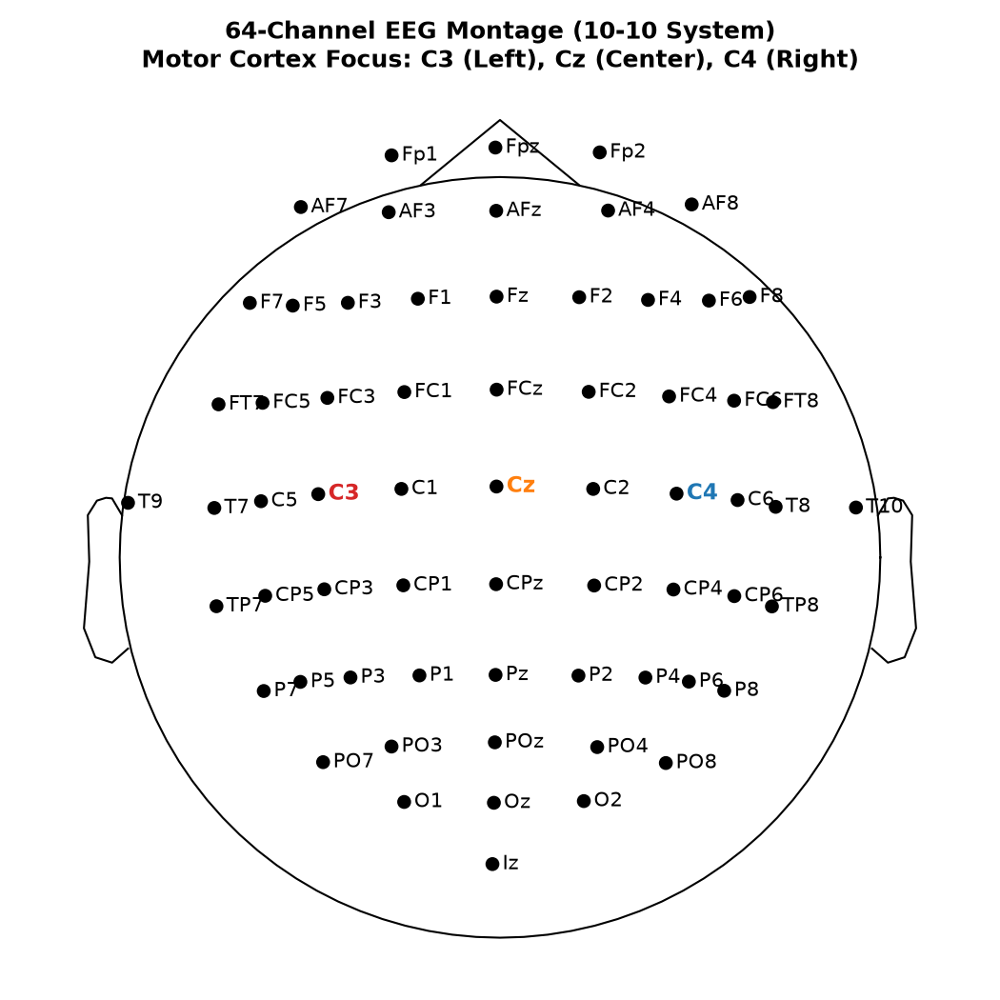
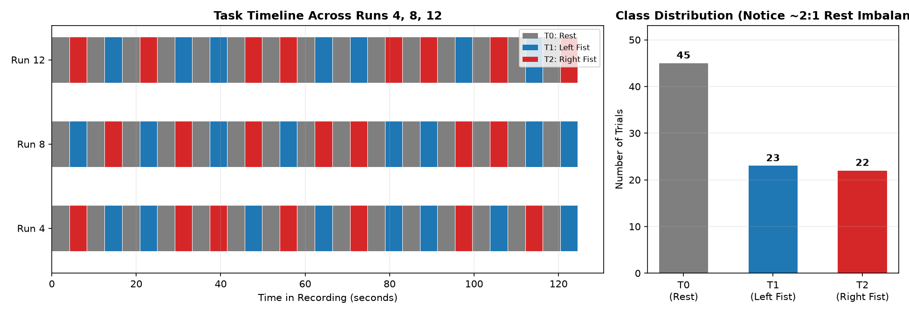

- **Class distribution:** `T0 Rest = 45` trials (`4.20 s` avg), `T1 Left = 23` trials (`4.10 s` avg), `T2 Right = 22` trials (`4.10 s` avg). Rest appears ~2× as often as each imagery class.

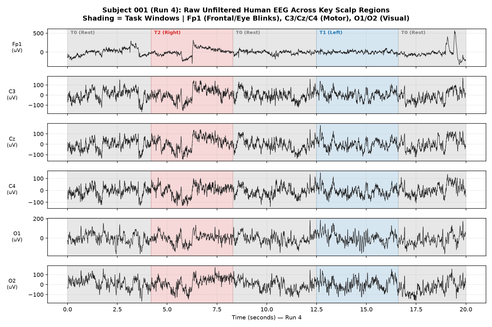
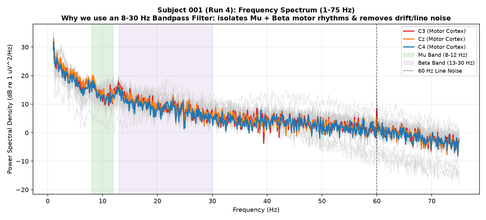

- **Raw signal characteristics:** Contains slow baseline drift (`< 5 Hz`), ocular blink spikes on frontal channels (`Fp1` reaches ~`500 µV` at `19.5 s`), and a `60 Hz` power-line spike. Motor rhythms sit in `8–12 Hz` (Mu) and `13–30 Hz` (Beta).

---

## Stage 1 · Step 2 — `8–30 Hz` Filtering & Motor Cortex Power

Applied an `8–30 Hz` bandpass filter and measured average signal power (`µV²`, `0.5–3.5 s` post-cue) over `C3` (left motor), `Cz` (center), and `C4` (right motor).

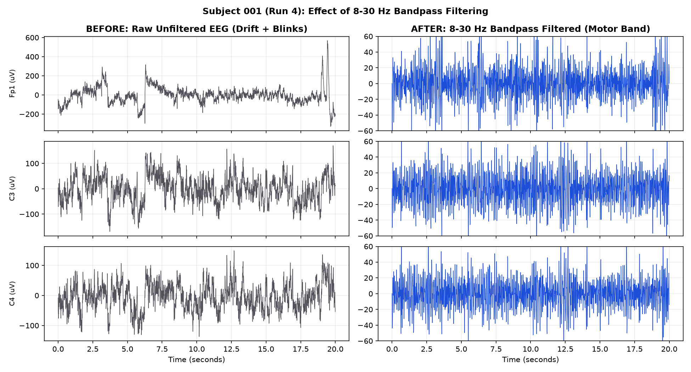
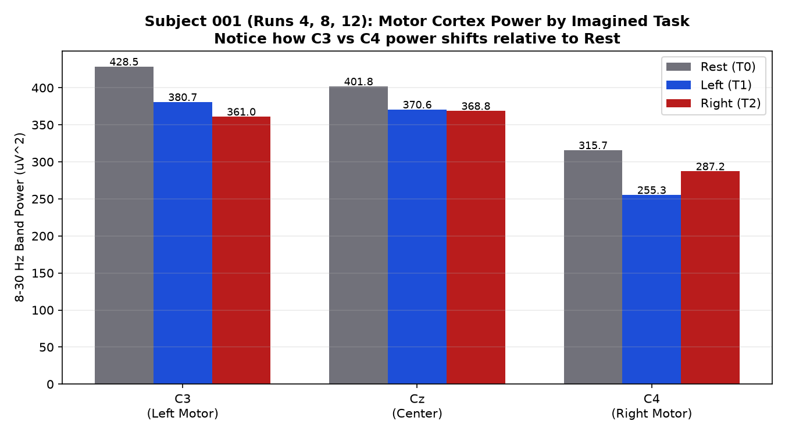

| Imagined Task | `C3` (Left Motor) | `Cz` (Center) | `C4` (Right Motor) |
| :--- | :---: | :---: | :---: |
| **Rest (`T0`)** | `428.51` | `401.79` | `315.70` |
| **Left Fist (`T1`)** | `380.73` | `370.63` | **`255.27`** (`-19.1%`) |
| **Right Fist (`T2`)** | **`360.96`** (`-15.8%`) | `368.75` | `287.22` |

- **Result:** Real data confirms contralateral desynchronization—imagining left-hand movement drops `8–30 Hz` power most strongly on `C4` (right hemisphere), while imagining right-hand movement drops it most strongly on `C3` (left hemisphere).

---

## Stage 1 · Step 3 — Baseline Classifiers (`CSP + LDA` vs. `PyRiemann`)

Evaluated 3-class classification (`Rest`, `Left`, `Right`) using strict **Leave-One-Run-Out** cross-validation across Runs `4, 8, 12` (zero train/test leakage).

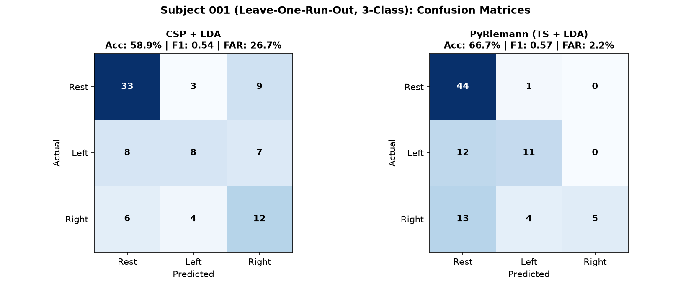
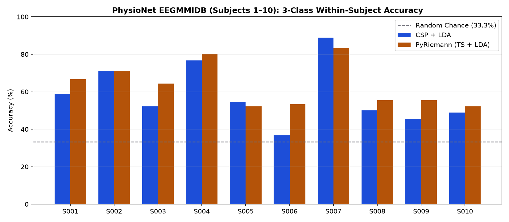

### Subject 001 Results
| Model | Accuracy | Macro-F1 | Rest False Activation Rate (`FAR`) | Latency / Window |
| :--- | :---: | :---: | :---: | :---: |
| **CSP + LDA** | `58.9%` | `0.539` | `26.7%` | `0.67 ms` |
| **PyRiemann (`TS + LDA`)** | **`66.7%`** | **`0.569`** | **`2.2%`** | `4.61 ms` |

### Subjects `001–010` Summary (Random Chance = `33.3%`)
- **Mean Accuracy:** `CSP + LDA = 58.3%` | **`PyRiemann = 63.4%`** (top responders: `S007` at `88.9%` / `83.3%`, `S004` at `80.0%`).
- **Mean Rest False Activation Rate (`FAR`):** `CSP + LDA = 29.6%` | **`PyRiemann = 5.1%`**.
- **Key Takeaway:** `PyRiemann` cuts accidental triggers during `Rest` by nearly **6×** (`29.6% → 5.1%`) while keeping inference under `5 ms`, making it far safer for hardware control.

---

## Stage 1 · Step 4 — Hypothesis Test: 21 Motor Channels & Two-Stage Gating

Tested whether restricting to 21 central/motor channels (`FC*`, `C*`, `CP*`) and using a two-stage gate (`Rest vs. Active` → `Left vs. Right`) improves over the 64-channel `PyRiemann` baseline (`63.4%` acc, `5.1%` FAR).

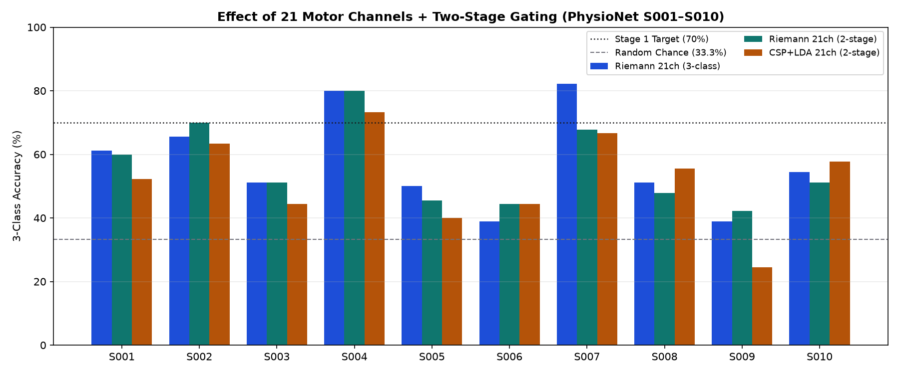

| Configuration (`S001–S010` Mean) | Accuracy | Macro-F1 | Rest FAR | Latency |
| :--- | :---: | :---: | :---: | :---: |
| **PyRiemann 64ch (3-class, Step 3)** | **`63.4%`** | **`0.569`** *(S1)* | **`5.1%`** | `4.61 ms` |
| **PyRiemann 21ch (3-class)** | `57.3%` | `0.525` | `28.7%` | `1.48 ms` |
| **PyRiemann 21ch (2-stage)** | `56.0%` | `0.508` | `29.3%` | `2.18 ms` |
| **CSP + LDA 21ch (2-stage)** | `52.2%` | `0.468` | `33.8%` | `0.68 ms` |

- **Scientific Finding:** Dropping the non-motor channels hurt both accuracy (`63.4% → 57.3%`) and Rest safety (`5.1% → 28.7%` FAR). Whole-head `64`-channel covariance captures posterior/parietal rest rhythms (`O1/O2/Pz`) that are essential for separating `Rest (T0)` from active imagery. **Keep all 64 channels.**

---

## Stage 1 · Step 5 — Multi-Dataset Validation & `EEGNet` Comparison

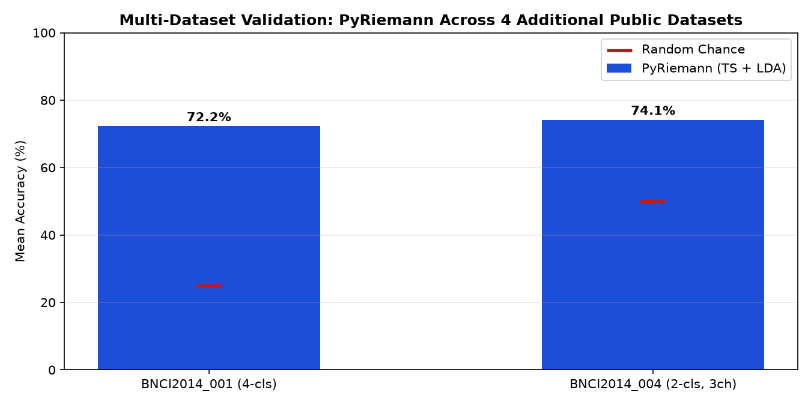
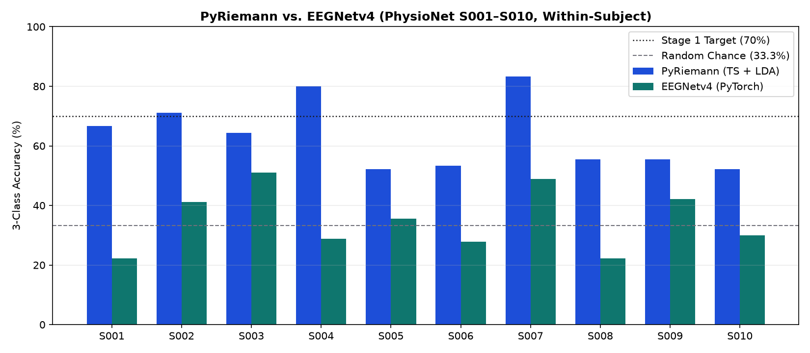

### Multi-Dataset Validation (`PyRiemann TS + LDA`)
| Dataset | Classes & Channels | Subjects | Mean Accuracy | Random Chance |
| :--- | :--- | :---: | :---: | :---: |
| **`BNCI2014_001`** | 4-class, 22 ch | 9 | **`72.2%`** | `25.0%` |
| **`BNCI2014_004`** | 2-class, 3 ch (`C3, Cz, C4`) | 9 | **`74.1%`** | `50.0%` |
| **`PhysionetMI`** | 3-class, 64 ch | 10 | **`63.4%`** | `33.3%` |

### `PyRiemann` vs. `EEGNet` (`PhysionetMI S001–S010`)
- **Within-Subject (`~60` training trials/fold):** `PyRiemann = 63.4%` (`5.1%` Rest FAR) vs. `EEGNet = 35.0%` (`76.9%` Rest FAR, `4.52 ms` latency). Small single-person datasets favor Riemannian geometry over neural networks.
- **Cross-Subject (Train `S001–S008` → Test unseen `S009–S010`):** `PyRiemann = 51.7%` vs. `EEGNet = 48.9%` (chance `33.3%`).

---

## Stage 1 · Step 6 — Model Export & Readiness Gate (`Calibrated Runs 4+8 → Unseen Run 12`)

Exported reusable inference module (`models/stage1_classifier.py`) and trained artifacts (`models/pyriemann_s001.joblib`, `models/pyriemann_s004.joblib`, `models/pyriemann_s007.joblib`).

| Subject | Accuracy (`>= 70%`) | Rest FAR (`<= 10%`) | Latency (`< 50 ms`) | Stage 1 Status |
| :--- | :---: | :---: | :---: | :--- |
| **`S004`** | **`80.0%`** (PASS) | **`0.0%`** (PASS) | **`6.08 ms`** (PASS) | **READY FOR STAGE 2** |
| **`S007`** | **`86.7%`** (PASS) | `13.3%` | `5.75 ms` (PASS) | Tune gate threshold |
| **`S001`** | `53.3%` | `0.0%` (PASS) | `5.49 ms` (PASS) | Weak responder |

---

## Next Stage · Stage 2 (Real-Time Simulation & ESP32 Control)
Replay `Subject 004`'s unseen `Run 12` at `160 samples/sec` with causal `8–30 Hz` filtering, feed sliding windows into `models/pyriemann_s004.joblib`, and trigger an ESP32 LED (`Rest` = no action, `Left` = ON, `Right` = OFF).

